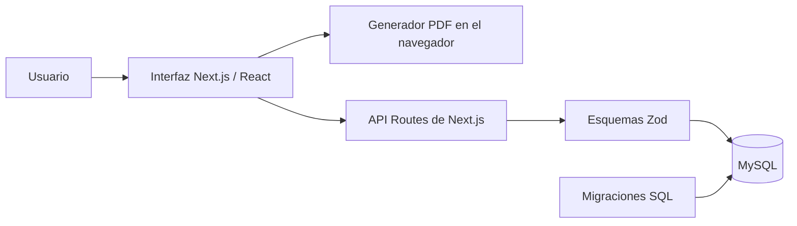

# Nexo Cotizaciones

Aplicación web para crear, organizar y convertir documentos comerciales: cotizaciones, documentos libres y cuentas de cobro. Está pensada para empresas que cotizan productos a medida —en especial ventanería, puertas y cabinas de baño— y necesitan calcular valores, guardar el historial de sus clientes y generar documentos PDF listos para compartir.

La interfaz y los mensajes están en español y el formato de las fechas está adaptado a `es-CO`.

## Contenido

- [Funciones principales](#funciones-principales)
- [Tecnologías](#tecnologías)
- [Arquitectura](#arquitectura)
- [Requisitos](#requisitos)
- [Instalación y ejecución](#instalación-y-ejecución)
- [Base de datos y migraciones](#base-de-datos-y-migraciones)
- [Uso de la aplicación](#uso-de-la-aplicación)
- [API HTTP](#api-http)
- [Estructura del proyecto](#estructura-del-proyecto)
- [Configuración de precios](#configuración-de-precios)
- [Limitaciones actuales](#limitaciones-actuales)

## Funciones principales

- Creación de **cotizaciones** con productos, medidas, cantidades, fechas de trabajo, plazo de entrega, garantía y observaciones.
- Cálculo automático del precio de seis tipos de producto: ventana corrediza, ventana fija, puerta vidriera, puerta batiente, fijo batiente y cabina de baño.
- Desglose del valor base y de accesorios según área, perímetro o unidades requeridas.
- Creación de **documentos libres** para presupuestos, propuestas y documentos comerciales personalizados.
- Creación y edición de **cuentas de cobro**, incluso a partir de una cotización o de un documento libre.
- Prevención de conversiones repetidas de un documento libre a cuenta de cobro.
- Generación en el navegador de PDF para los tres tipos de documento.
- Portafolio unificado para consultar documentos guardados, convertir cotizaciones, editar cuentas de cobro y eliminar registros.
- Directorio de clientes reutilizable en los formularios.
- Validación de datos en la API con Zod y mensajes de error en español.
- Migraciones SQL versionadas e idempotentes para MySQL.

## Tecnologías

| Área | Implementación |
| --- | --- |
| Framework | Next.js 16 con App Router |
| Lenguaje | TypeScript |
| Interfaz | React 19, Tailwind CSS, Radix UI y Lucide |
| Formularios y validación | React Hook Form, Zod y `@hookform/resolvers` |
| Base de datos | MySQL mediante `mysql2` |
| PDF | jsPDF y `jspdf-autotable` |
| Utilidades | date-fns, clsx y tailwind-merge |

## Arquitectura



Las pantallas del cliente realizan solicitudes a las rutas `app/api`. Estas validan el cuerpo de la petición, llaman a la capa `lib/database.ts` y almacenan la información en MySQL. La descarga de PDF se produce localmente en el navegador; la aplicación no sube PDFs a un servicio de archivos.

## Requisitos

- Node.js 20 o superior.
- npm (incluido con Node.js).
- MySQL 8+ o MySQL incluido en XAMPP.

> La guía ampliada para XAMPP y phpMyAdmin está disponible en [INSTRUCCIONES_XAMPP.md](INSTRUCCIONES_XAMPP.md).

## Instalación y ejecución

1. Clona el repositorio e instala las dependencias:

   ```bash
   git clone https://github.com/daviddiazgomez370-star/Plantillas-Cotizaci-n.git
   cd Plantillas-Cotizaci-n
   npm ci
   ```

2. Crea la configuración local de base de datos a partir del ejemplo:

   ```bash
   # macOS / Linux
   cp .env.local.example .env.local

   # Windows PowerShell
   Copy-Item .env.local.example .env.local
   ```

3. Ajusta `.env.local` con las credenciales de tu servidor MySQL:

   ```env
   DB_HOST=localhost
   DB_PORT=3306
   DB_USER=root
   DB_PASSWORD=
   DB_NAME=cotizaciones_db
   ```

4. Revisa las migraciones disponibles y aplica la estructura de datos:

   ```bash
   npm run db:migrate:dry-run
   npm run db:migrate
   ```

5. Inicia el entorno de desarrollo:

   ```bash
   npm run dev
   ```

6. Abre [http://localhost:3000](http://localhost:3000).

### Comandos disponibles

| Comando | Descripción |
| --- | --- |
| `npm run dev` | Inicia Next.js en desarrollo. |
| `npm run build` | Genera la compilación de producción. |
| `npm run start` | Sirve la compilación de producción. |
| `npm run lint` | Ejecuta ESLint sobre el proyecto. |
| `npm run db:migrate:dry-run` | Lista las migraciones sin conectarse ni modificar datos. |
| `npm run db:migrate` | Crea la base de datos si es necesario y aplica las migraciones pendientes. |
| `npm run db:migrate:status` | Muestra las migraciones ya aplicadas y pendientes. |

## Base de datos y migraciones

El migrador `scripts/migrate.js` carga `.env.local`, crea `cotizaciones_db` si no existe y lleva el registro de ejecuciones en la tabla `schema_migrations`. Cada archivo en `scripts/migrations/` tiene una versión y una suma de comprobación SHA-256; si se cambia una migración ya aplicada, el comando se detiene para proteger el historial.

No edites una migración que ya esté aplicada. Para cambiar el esquema, crea una nueva migración numerada, por ejemplo `005_descripcion_del_cambio.sql`.

### Tablas principales

| Tabla | Propósito |
| --- | --- |
| `quotations` | Cotizaciones con cliente, empresa, productos JSON, importes, fechas y estado. |
| `free_documents` | Documentos personalizados con ítems, total y estado. |
| `invoices` | Cuentas de cobro; pueden referenciar una cotización o un documento libre. |
| `clients` | Datos reutilizables de clientes. |
| `schema_migrations` | Historial y verificación de migraciones aplicadas. |

Los campos de productos e ítems se almacenan como JSON. Las relaciones de `invoices` usan claves foráneas opcionales: al eliminar el documento de origen, la referencia queda en `NULL` y la cuenta de cobro se conserva.

También se mantienen scripts SQL manuales en `scripts/` para instalaciones antiguas. Para instalaciones nuevas, usa exclusivamente el migrador con `npm run db:migrate`.

## Uso de la aplicación

| Ruta | Función |
| --- | --- |
| `/` | Resumen y accesos rápidos. |
| `/plantillas` | Selección de cotización, documento libre o cuenta de cobro. |
| `/cotizacion` | Formulario de cotización con cálculo por medidas y accesorios. |
| `/documento-libre` | Formulario de propuesta o documento personalizado. |
| `/cuenta-cobro` | Creación y edición de cuentas de cobro. |
| `/portafolio` | Consulta centralizada y conversión de documentos. |
| `/clientes` | Administración del directorio de clientes. |
| `/configuracion` | Edición local de precios y accesorios. |

### Flujo de trabajo sugerido

1. Registra los datos de un cliente en **Clientes**.
2. Crea una **Cotización** y selecciona ese cliente para completar sus datos.
3. Agrega los productos, medidas en centímetros y cantidades. El total se actualiza a partir de los precios base y accesorios definidos en `lib/pricing.ts`.
4. Guarda la cotización para verla en **Portafolio** o descarga su PDF.
5. Cuando el trabajo se convierta en cobro, genera una **Cuenta de cobro** desde el portafolio. La cotización queda marcada como convertida.

Los documentos libres siguen un flujo equivalente. Al convertir uno en cuenta de cobro, la API comprueba de forma transaccional que el documento no haya sido convertido anteriormente.

## API HTTP

Todas las respuestas son JSON. Las solicitudes de creación y actualización validan sus datos en el servidor. Un cuerpo inválido recibe `400` con el primer mensaje de validación y el detalle de campos; los errores inesperados reciben `500`.

| Método | Ruta | Operación |
| --- | --- | --- |
| `GET` | `/api/quotations` | Lista cotizaciones. |
| `POST` | `/api/quotations` | Crea una cotización. |
| `DELETE` | `/api/quotations/:id` | Elimina una cotización. |
| `PATCH` | `/api/quotations/:id/status` | Cambia el estado: `pending`, `approved`, `converted` o `cancelled`. |
| `GET` | `/api/free-documents` | Lista documentos libres. |
| `POST` | `/api/free-documents` | Crea un documento libre. |
| `GET` / `PUT` / `DELETE` | `/api/free-documents/:id` | Consulta, actualiza o elimina un documento libre. |
| `GET` | `/api/invoices` | Lista cuentas de cobro. |
| `POST` | `/api/invoices` | Crea una cuenta de cobro; acepta un origen de documento libre. |
| `GET` / `PUT` / `DELETE` | `/api/invoices/:id` | Consulta, actualiza o elimina una cuenta de cobro. |
| `GET` | `/api/clients` | Lista clientes. |
| `POST` | `/api/clients` | Crea un cliente. |
| `GET` / `PUT` / `DELETE` | `/api/clients/:id` | Consulta, actualiza o elimina un cliente. |

## Estructura del proyecto

```text
app/
  api/                  # Endpoints HTTP de cotizaciones, cuentas, documentos y clientes
  clientes/             # Directorio de clientes
  configuracion/        # Configuración visual de precios y accesorios
  cotizacion/           # Formulario de cotización
  cuenta-cobro/         # Formulario de cuenta de cobro
  documento-libre/      # Formulario de documento personalizado
  plantillas/           # Selector de formatos
  portafolio/           # Historial y conversiones
components/
  ui/                   # Componentes base de Radix/Shadcn
  *-form.tsx            # Formularios principales
  portfolio-view.tsx    # Portafolio de documentos
lib/
  database.ts           # Operaciones de acceso a datos
  mysql.ts              # Pool de conexiones MySQL
  pricing.ts            # Catálogo y cálculo de precios
  pdf-generator.ts      # Generadores de PDF
  validations.ts        # Esquemas y normalización de peticiones
scripts/
  migrate.js            # Ejecutable de migraciones
  migrations/           # Evolución versionada del esquema
```

## Configuración de precios

Los precios base y accesorios predeterminados están centralizados en `lib/pricing.ts`. Para cada producto, el cálculo considera:

- Área: `(ancho × alto) / 10 000`, con medidas ingresadas en centímetros.
- Perímetro: `2 × (ancho + alto) / 100`, en metros.
- Precio base por metro cuadrado.
- Accesorios requeridos por metro cuadrado, por metro lineal o por unidad.

La pantalla **Configuración** permite modificar precios y accesorios durante la sesión y guarda esos valores en `localStorage` del navegador.

## Limitaciones actuales

- Los valores modificados en **Configuración** no se cargan aún en `lib/pricing.ts`; por ello, el cálculo de nuevas cotizaciones continúa usando el catálogo predeterminado mientras no se integre esa persistencia.
- No hay autenticación ni control de permisos. Antes de publicar la aplicación, incorpora autenticación, autorización y protección adicional de la API.
- La conexión MySQL se configura mediante variables locales. Nunca subas `.env.local` ni credenciales al repositorio.
- Los PDFs se generan para descarga en el navegador; no existe almacenamiento remoto ni una URL de PDF persistida.

## Seguridad y contribución

El archivo `.env.local` está ignorado por Git. Usa `.env.local.example` como plantilla y conserva las credenciales fuera del control de versiones.

Antes de proponer cambios, verifica al menos:

```bash
npm run db:migrate:dry-run
npm run build
```

Cuando modifiques el esquema, añade una migración nueva, pruébala en una base local y actualiza esta documentación si cambia el flujo de instalación o uso.

## Licencia

Este repositorio no incluye una licencia explícita. Añade un archivo `LICENSE` antes de distribuirlo bajo condiciones determinadas.
